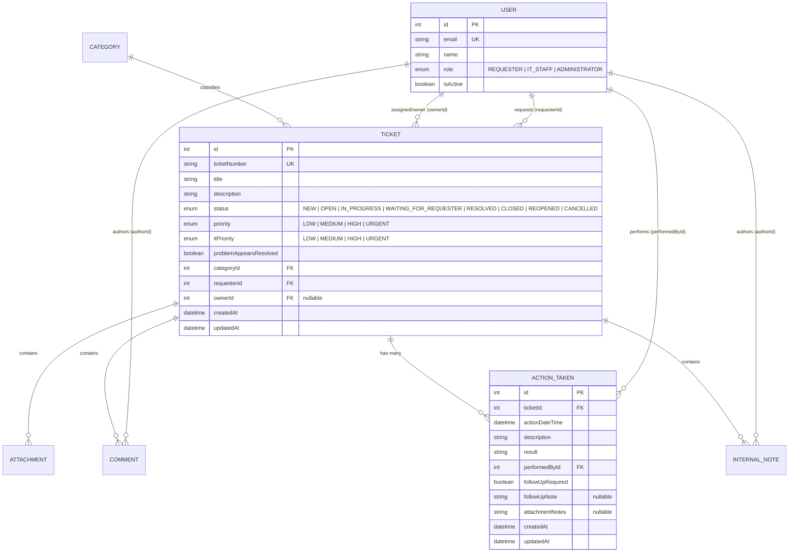

# TokTickIT Lab 4 — Engineering Specification

**Document Version:** 1.0.0  
**Status:** Approved for Implementation (Spec-DD Deliverable)  
**Target Sprint:** Lab 4 — TokTickIT Actions Taken, Dashboards, and Final Regression  
**Authors:** Sorawit Chaitong (@DEV4952)  
**Course:** CPE 334 Introduction to Software Engineering in the Age of AI Agents (Semester 1/2026)  

---

## 1. Sprint Goal

Deliver the concluding product increment for the TokTickIT service-desk system by implementing a parent-child work tracking subsystem (**Actions Taken**), role-tailored operational **Dashboards** for Requesters, IT Staff, and Administrators, an authoritative **Ticket Status Lifecycle** with strict server-side resolution gating and optimistic concurrency conflict protection (HTTP 409), and full regression preservation across all capabilities delivered in Labs 1 through 3 under the Zen Green design system.

---

## 2. Stakeholder Request Interpretation

The stakeholder statement defines the operational and analytical requirements that TokTickIT must fulfill in Sprint 4:

> *"The service desk can now receive Tickets and IT Staff can communicate with Requesters, but we still need a reliable way to plan and track the actual work. Add Actions Taken under each Ticket. Each action should contain Action Date/Time, Action Description, Result, Performed by (auto), Follow-Up Required?, Follow-up Note (required when follow-up is needed), Attachment Notes (what file to look for images etc.).*  
> *The primary Ticket Owner remains responsible for coordinating the Ticket as a whole. Requesters may continue to indicate that the problem appears resolved, but IT Staff must review the work and formally update the Ticket.*  
> *Add useful dashboards for Requesters and IT Staff, but keep them concise and connected to the detailed screens. Finally, polish and harden the complete application so that all earlier features continue to work consistently under the Zen Green design language."*

### Key Architectural Takeaways:
1. **Separation of Incident Coordination vs. Action Execution:** A ticket represents the overall customer incident assigned to a primary Ticket Owner (`ownerId`). However, technical resolution frequently involves multiple specialists recording individual interventions. Actions Taken establishes this one-to-many relationship (`Ticket 1 ── * ActionTaken`) with automated performer attribution (`performedById` bound to the authenticated user).
2. **Conditional Follow-up Integrity:** When `Follow-Up Required` is checked, the system mandates entering a `Follow-up Note` so that unresolved or pending technical checks are never left undocumented.
3. **Formal Resolution Gate:** Customer cues indicating that a problem appears resolved (`problemAppearsResolved = true`) are strictly advisory and cannot bypass formal IT Staff review or directly alter the ticket status to `RESOLVED` or `CLOSED`.
4. **Authoritative, Concise Dashboards:** Dashboards present high-level operational metrics calculated server-side from live data, enabling one-click drill-downs into filtered queues without downloading entire ticket collections to client memory.
5. **End-to-End System Hardening:** Zero regressions across legacy capabilities (authentication, RBAC, attachments, public comments, internal notes, and administrative user governance).

---

## 3. Scope & Explicit Exclusions

### 3.1. In-Scope Work
- **Actions Taken Persistence & Model:** Prisma model `ActionTaken`, foreign keys to `Ticket` (`onDelete: Cascade`) and `User` (`performedById`), indexes, and schema migrations preserving all prior data.
- **Actions Taken APIs & Business Rules:** Secure REST endpoints for creating, listing, inspecting, and editing actions, enforcing automated attribution, inactive user rejection, and conditional follow-up note validation.
- **Actions Taken UI (Zen Green):** Embedded table/list within Ticket Detail, create/edit modal forms with real-time validation, and strict read-only rendering for Requesters.
- **Role-Appropriate Dashboards:**
  - **Requester Dashboard:** Scoped strictly to authenticated customer tickets, showing `My Open Tickets`, `Waiting for Requester`, `In Progress`, `Resolved`, and `Closed` metrics, recent activity, and quick links.
  - **IT Staff Dashboard:** Team operational metrics (`New`, `Open`, `In Progress`, `Waiting for Requester`, `My Assigned`, `Unassigned`), daily deltas (`+1 from yesterday`), status/priority distributions, recent activity, and queue drill-downs.
  - **Administrator Dashboard:** Reuses the IT Staff dashboard operational view augmented with concise system user account counts.
- **Ticket Workflow Lifecycle & Concurrency Control:** Server-side state machine enforcing valid transitions, advisory handling of customer resolution cues, and optimistic concurrency conflict handling (`409 Conflict`) using `updatedAt` timestamps.
- **Data Migration, Rollback & Seed:** Backward-compatible migrations for legacy tickets without actions, explicit rollback plan, and idempotent seed covering all status/priority variations.
- **Final Hardening & Regression:** End-to-end regression verification across all Lab 1–3 functionality.

### 3.2. Explicitly Excluded (Out-of-Scope)
As mandated by Lab 4 Handout Section 4.2:
- Automatic SLA countdown clocks, breach notifications, and automated escalation engines.
- External notification channels (Email, SMS, LINE, Webhooks, Push notifications).
- Inventory consumption, spare-parts procurement, hardware tracking, or service cost accounting.
- Timesheet billing, technician hourly rates, and payroll/labor-cost calculations.
- Multi-level electronic approval workflows and digital signature capture.
- Advanced business-intelligence (BI) report builders, OLAP cubes, or CSV/data warehouse exporters.
- Multi-tenant organizational partitioning and production-scale cloud clustering.
- Unapproved feature creep not ratified in this engineering contract.

---

## 4. Numbered Functional Requirements

### 4.1. Actions Taken Subsystem
- **FR-01 (Actions Taken Persistence):** The system shall persist Action Taken lines under a parent Ticket, recording `actionDateTime`, `description`, `result`, `performedById`, `followUpRequired`, `followUpNote`, and `attachmentNotes`.
- **FR-02 (Automatic Performer Attribution):** The system shall automatically bind `performedById` to the authenticated user from the active session. Client-supplied performer IDs in request bodies or query parameters shall be ignored or rejected.
- **FR-03 (Conditional Follow-Up Validation):** The system shall strictly mandate a non-empty `followUpNote` (minimum 3 characters) if and only if `followUpRequired` is `true`. If `followUpRequired` is `false`, `followUpNote` shall be cleared or stored as `null`.
- **FR-04 (Create & Update Actions Taken):** The system shall allow authenticated IT Staff and Administrators to create and update Actions Taken records for any accessible ticket.
- **FR-05 (Requester Read-Only Access):** The system shall allow Requesters to view all Actions Taken lines on tickets they own, but shall strictly prohibit Requesters from creating, updating, or deleting Actions Taken (`403 Forbidden`).
- **FR-06 (Inactive User Safeguard):** The system shall reject creating or modifying Actions Taken attributed to inactive user accounts (`isActive = false`) with an informative validation error.
- **FR-07 (Attachment Notes Reference):** The system shall support optional `attachmentNotes` on Actions Taken to reference relevant uploaded files or diagnostic screenshots without altering the underlying attachment storage system.

### 4.2. Ticket Workflow & Resolution Gating
- **FR-08 (State Machine Transition Enforcement):** The system shall enforce permitted ticket status transitions among: `NEW`, `OPEN`, `IN_PROGRESS`, `WAITING_FOR_REQUESTER`, `RESOLVED`, `CLOSED`, `REOPENED`, and `CANCELLED`. Unauthorized or non-sequential jumps shall be rejected (`400 Bad Request`).
- **FR-09 (Advisory Requester Resolution):** The system shall treat Requester-submitted "Problem Appears Resolved" cues as advisory metadata (`problemAppearsResolved = true`), keeping the ticket status unchanged until an IT Staff member or Administrator formally transitions it to `RESOLVED` or `CLOSED`.
- **FR-10 (Optimistic Concurrency Control):** The system shall require client submissions for ticket status updates to supply the known `currentUpdatedAt` timestamp. If the server's record has a newer timestamp, the update shall be rejected with HTTP `409 Conflict` containing the latest ticket state.

### 4.3. Role-Appropriate Dashboards
- **FR-11 (Requester Dashboard Endpoint):** GET /api/dashboard/requester returns session-owned counts (myOpenTickets, waitingForRequester, recentlyUpdated, recentlyResolved, inProgress, resolved, closed) and up to five recent five-field ticket summaries. Recent counts use an inclusive rolling seven-day UTC window; recentlyResolved means current RESOLVED tickets updated in that window, not resolution events.
- **FR-12 (IT Staff Dashboard Endpoint):** GET /api/dashboard/staff returns authoritative newCount, openCount, inProgressCount, waitingRequesterCount, myAssignedCount and unassignedCount, numeric BR-12 daily deltas, complete status/IT-priority breakdowns and up to five recent ticket summaries. All queries share one Repeatable Read snapshot.
- **FR-13 (Administrator Dashboard View):** ADMINISTRATOR callers of GET /api/dashboard/staff additionally receive userMetrics (totalUsers, activeUsers, inactiveUsers, requesterCount, itStaffCount, adminCount). IT_STAFF callers never receive account statistics. The earlier separate /api/dashboard/admin proposal is superseded by Issue #65.
- **FR-14 (Authoritative Server Computation):** All dashboard metrics and card figures shall be computed directly by backend database aggregations, guaranteeing authoritative counts.
- **FR-15 (Dashboard Drill-Down Navigation):** Every dashboard metric card and list item shall link to a filtered Ticket Queue or Ticket Detail view corresponding to that operational slice.

### 4.4. Final Hardening & Regression
- **FR-16 (Regression Preservation):** The system shall preserve full operational capability for all Lab 1–3 features: Authentication, Password Resets, Ticket Creation, File Attachments, Public Comments, Internal Notes, and User Management.
- **FR-17 (Safe Failure & Double-Submit Protection):** The UI shall disable submission buttons during network in-flight states and protect entered form data in the event of recoverable network or validation failures.

---

## 5. Numbered Business Rules

| Rule ID | Category | Business Rule Statement |
|---|---|---|
| **BR-01** | **Actions Taken** | An Action Taken belongs to exactly one parent Ticket (`Ticket 1 ── * ActionTaken`). Orphaned Actions Taken are strictly prohibited. |
| **BR-02** | **Coordination vs Action** | The Ticket Owner coordinates the Ticket, but an Action Taken may be performed and recorded by a different IT Staff member or Administrator. |
| **BR-03** | **Actor Attribution** | The `performedById` field must be resolved exclusively from the authenticated session token. Clients cannot forge or reassign the performer identity. |
| **BR-04** | **Follow-Up Invariant** | If `followUpRequired === true`, `followUpNote` is mandatory (min 3 non-whitespace characters). If `followUpRequired === false`, `followUpNote` must be null or omitted. |
| **BR-05** | **Requester Read-Only** | Requesters have read-only visibility for Actions Taken on owned tickets (`requesterId === session.userId`). Write attempts by Requesters are blocked with `403 Forbidden`. |
| **BR-06** | **Permitted Transition Matrix** | Ticket status changes must strictly comply with the authorized transition graph:<br>• `NEW` ➔ `OPEN`, `IN_PROGRESS`, `CANCELLED`<br>• `OPEN` ➔ `IN_PROGRESS`, `WAITING_FOR_REQUESTER`, `RESOLVED`, `CANCELLED`<br>• `IN_PROGRESS` ➔ `WAITING_FOR_REQUESTER`, `RESOLVED`, `CANCELLED`<br>• `WAITING_FOR_REQUESTER` ➔ `IN_PROGRESS`, `RESOLVED`, `CANCELLED`<br>• `RESOLVED` ➔ `CLOSED`, `REOPENED`<br>• `CLOSED` ➔ `REOPENED`<br>• `REOPENED` ➔ `IN_PROGRESS`, `RESOLVED`<br>• `CANCELLED` ➔ *(Terminal state; no outward transitions permitted)*. |
| **BR-07** | **Resolution Gate** | A Requester indication that the problem appears resolved is advisory and does not itself change the Ticket status to `RESOLVED` or `CLOSED`. Only IT Staff or Administrators may formally update the status. |
| **BR-08** | **Optimistic Concurrency** | State transitions and core workflow modifications require supplying the client's known `updatedAt` timestamp. If the server record contains a newer timestamp, the transaction is aborted with HTTP `409 Conflict`. |
| **BR-09** | **Requester Data Isolation** | Requester dashboard metrics and recent ticket queries are strictly filtered by `requesterId = session.userId`. Requesters never receive operational metrics of other users. |
| **BR-10** | **Authoritative Calculations** | Dashboard card numbers must be calculated server-side from live database queries. Empty query results must display `0` rather than null or missing UI elements. |
| **BR-11** | **Inactive User Safeguard** | Users with `isActive = false` cannot be assigned as Ticket Owners, recorded as action performers, or authenticated to perform modifications. |
| **BR-12** | **Creation-Cohort Daily Deltas** | Using one UTC referenceTime, compare tickets created in [today UTC midnight, referenceTime] with [previous UTC midnight, today UTC midnight). Group by current status or current ownerId. Return today minus yesterday, with neutral numeric 0 if that group had no records yesterday (Decision 1). This does not reconstruct historical queue changes. |

---

## 6. UI Specification Summary

Complete UI layouts, Zen Green tokens, wireframes, and responsive behaviors are detailed in [`docs/lab-04/ui-spec.md`](file:///c:/toktickit/docs/lab-04/ui-spec.md).

### 6.1. Navigation & App Shell
- **Role-Aware Header:**
  - Requester: `[Dashboard]`, `[My Tickets]`, `[Create Ticket]`, `[Profile Dropdown]`.
  - IT Staff: `[Dashboard]`, `[Ticket Queue]`, `[Create Ticket]`, `[Profile Dropdown]`.
  - Administrator: `[Dashboard]`, `[Ticket Queue]`, `[User Management]`, `[Create Ticket]`, `[Profile Dropdown]`.
- Active route highlighted with Zen Green indicator border (`--color-zen-primary-hover`).

### 6.2. IT Staff Dashboard Screen (`/dashboard`, IT_STAFF/ADMINISTRATOR)
- **Header:** Welcome banner (`Welcome back, Michael!`) with dynamic date summary and manual `[ Refresh ]` trigger.
- **Metric Cards (5 Cards):** `New`, `Open`, `In Progress`, `Waiting for Requester`, `My Assigned`.
  - Displays count value (32px bold) + delta subtext (`+2 from yesterday`).
  - Clicking any card navigates to the Ticket Queue filtered by that status/owner.
- **Recent Tickets List:** 5 most recently updated operational tickets with status pills, priority badges, and links to Ticket Detail.
- **Quick Actions Panel:** Direct shortcuts for `Create Ticket`, `Search Tickets`, and `My Queue`.

### 6.3. Requester Dashboard Screen (`/dashboard`, REQUESTER)
- **Header:** Personalized customer greeting (`Welcome, Jennifer!`).
- **Metric Cards (4 Cards):** `My Open Tickets`, `In Progress`, `Resolved`, `Closed`. Each card provides a "View all" drill-down link to the filtered My Tickets view.
- **My Recent Tickets:** Table/cards of the customer's 5 most recent requests.
- **Quick Actions:** Shortcuts for `Create Ticket` and `View My Tickets`.

### 6.4. Actions Taken on Ticket Detail
- **Location:** Dedicated prominent section on the Ticket Detail screen (`/staff/tickets/:id` and `/tickets/:id`).
- **IT Staff View:**
  - Header with count badge and `[ + Add Action Taken ]` button.
  - Data table / card list: Date/Time, Description, Result, Performed By, Follow-Up Status/Note, Attachment Notes, and `[ Edit ]` action.
  - Create / Edit modal with accessible form validation and automatic performer display.
- **Requester View:**
  - Identical data presentation in read-only mode (`+ Add Action Taken` and `Edit` buttons omitted from DOM).

---

## 7. Data Changes, Migration & Recovery Strategy

### 7.1. Entity Relationship Model


### 7.2. Prisma Model Definition
```prisma
enum ActionTakenStatus {
  RECORDED
  IN_PROGRESS
  COMPLETED
  CANCELLED
}

model ActionTaken {
  id       String @id @default(cuid())
  ticketId Int
  ticket   Ticket @relation(fields: [ticketId], references: [id], onDelete: Cascade)

  status     ActionTakenStatus    @default(RECORDED)
  assigneeId Int?
  assignee   User?                @relation("ActionAssignee", fields: [assigneeId], references: [id], onDelete: SetNull)
  history    ActionTakenHistory[]

  actionDateTime DateTime @default(now())
  description    String   @db.Text
  result         String   @db.Text

  performedById Int
  performedBy   User @relation(fields: [performedById], references: [id], onDelete: Restrict)

  followUpRequired Boolean @default(false)
  followUpNote     String? @db.Text
  attachmentNotes  String? @db.Text

  createdAt DateTime @default(now())
  updatedAt DateTime @updatedAt

  @@index([assigneeId])
  @@index([status])
  @@index([ticketId])
  @@index([performedById])
  @@index([actionDateTime])
  @@index([createdAt])
  @@map("actions_taken")
}

model ActionTakenHistory {
  id        String      @id @default(cuid())
  actionId  String
  action    ActionTaken @relation(fields: [actionId], references: [id], onDelete: Cascade)
  actorId   Int
  actor     User        @relation(fields: [actorId], references: [id], onDelete: Restrict)
  event     String
  before    Json?
  after     Json
  createdAt DateTime    @default(now())

  @@index([actionId, createdAt])
  @@index([actorId])
  @@map("action_taken_history")
}
```

### 7.3. Justified Architectural Decisions (Mandatory per Section 5.1)

#### Decision 1: Parent-Child Cascading Delete with Audit Safeguard
- **Decision:** Foreign key `ActionTaken.ticketId` is configured with `onDelete: Cascade` at the database level.
- **Justification:** An Action Taken line represents work performed exclusively on a specific ticket; it has no independent business value outside of its parent ticket (BR-01). Enforcing cascading delete ensures that if a ticket is purged during test suite teardowns or administrative maintenance, no orphan action records can remain to corrupt aggregations. In operational practice, tickets are soft-closed (`CLOSED` status) rather than deleted, guaranteeing permanent audit preservation.

#### Decision 2: Optimistic Concurrency Control via `updatedAt` Verification
- **Decision:** Status transitions and core workflow mutations accept the client's known `currentUpdatedAt` timestamp. The database update applies an atomic check (`WHERE id = :id AND updatedAt = :clientUpdatedAt`). If the record has been modified by another actor, the server aborts with HTTP `409 Conflict`.
- **Justification:** Service desks involve multiple concurrent agents (e.g., ticket coordinator adjusting priority while a technician resolves the ticket). Optimistic concurrency prevents the "Lost Update Problem" without introducing heavy distributed locking mechanisms, ensuring technicians never unknowingly overwrite another user's status transition.

#### Decision 3: Separation of Ticket Coordinator (`ownerId`) and Work Performer (`performedById`)
- **Decision:** Actions Taken maintain a dedicated `performedById` referencing the technician who executed the task, independent of the parent Ticket's `ownerId`.
- **Justification:** Real IT support workflows frequently involve specialized team members (e.g., network engineers, hardware technicians) executing specific tasks on tickets owned by a lead service coordinator. Allowing different performers per action while keeping a single coordinating owner matches real organizational practice and preserves complete accountability without constant ticket reassignment.

### 7.4. Migration, Backfill, and Rollback Strategy

1. **Zero Data Loss Migration:** The migration executes `CREATE TABLE "actions_taken"` and creates associated foreign keys and indexes. All existing columns on `users`, `tickets`, `categories`, `comments`, `internal_notes`, and `attachments` remain completely untouched.
2. **Backfill & Legacy Ticket Compatibility:** Existing tickets from Labs 1 through 3 naturally have zero `actions_taken` rows. Backend queries utilize `LEFT JOIN` or Prisma `include: { actionsTaken: true }`, ensuring legacy tickets seamlessly return an empty array `[]` without null-pointer exceptions or migration backfill scripts required.
3. **Rollback & Recovery Plan:**
   - In the event of migration failure, the schema rollback drops the `actions_taken` table:
     ```sql
     DROP TABLE IF EXISTS "actions_taken" CASCADE;
     ```
   - Because `actions_taken` is an isolated child table, rolling back does not alter or corrupt any legacy data in `tickets` or `users`.
   - Automated database backup is taken prior to applying migration in staging/production environments.

### 7.5. Idempotent Seed Strategy
The database seed script (`server/prisma/seed.ts`) executes safely and repeatedly using `upsert` queries:
- **Zero Actions:** Legacy tickets left with zero actions to demonstrate clean UI empty states.
- **Single Action:** Tickets with 1 recorded action.
- **Multiple Actions:** Tickets with 3+ actions logged by different IT Staff members.
- **Follow-Up Coverage:** Actions demonstrating both `followUpRequired = false` (null note) and `followUpRequired = true` (detailed follow-up note).
- **Status & Priority Coverage:** Tickets spanning every status (`NEW`, `OPEN`, `IN_PROGRESS`, `WAITING_FOR_REQUESTER`, `RESOLVED`, `CLOSED`, `REOPENED`, `CANCELLED`) to verify non-zero dashboard metric cards.

---

## 8. REST API Contract Summary

Complete endpoint schemas, JSON payloads, and response codes are defined in [`docs/lab-04/api-spec.md`](file:///c:/toktickit/docs/lab-04/api-spec.md).

| Group | Method | Endpoint | Allowed Roles | Description |
|---|---|---|---|---|
| **Actions Taken** | `POST` | `/api/tickets/:ticketId/actions` | IT Staff, Admin | Create a new Action Taken line |
| **Actions Taken** | `GET` | `/api/tickets/:ticketId/actions` | Owner Requester, IT Staff, Admin | List all Actions Taken for a ticket |
| **Actions Taken** | `GET` | `/api/tickets/:ticketId/actions/:id/history` | Owner Requester, IT Staff, Admin | Read append-only Action Taken history |
| **Actions Taken** | `PATCH` | `/api/tickets/:ticketId/actions/:id` | IT Staff, Admin | Update an Action Taken line |
| **Dashboard** | `GET` | `/api/dashboard/requester` | Requester | Authoritative Requester metrics and recent list |
| **Dashboard** | `GET` | `/api/dashboard/staff` | IT Staff, Admin | Authoritative IT Staff operational metrics and recent list |
| **Workflow** | `PATCH` | `/api/staff/tickets/:id/status` | IT Staff, Admin | Transition ticket status with concurrency check (`409`) |
| **Workflow** | `POST` | `/api/tickets/:id/resolve-indication`| Owner Requester | Submit advisory resolution flag (Preserved Lab 3) |

---

## 9. Acceptance Criteria

| ID | Given | When | Then |
|---|---|---|---|
| **AC-01** | An authenticated IT Staff member and valid ticket | Staff posts valid Action Taken data (description, result, date-time) | The action is saved under the ticket with `performedById = session.userId` and returns `201 Created`. |
| **AC-02** | An authenticated IT Staff member | Staff submits an action with `followUpRequired = true` and empty `followUpNote` | The server rejects the request with HTTP `400 Bad Request` citing mandatory follow-up note. |
| **AC-03** | An authenticated Requester | Requester attempts to `POST /api/tickets/:id/actions` | The server rejects the request with HTTP `403 Forbidden` and creates no record. |
| **AC-04** | An authenticated Requester on an owned ticket | Requester navigates to Ticket Detail | The UI displays all Actions Taken lines recorded by IT Staff in read-only mode with action buttons omitted. |
| **AC-05** | An authenticated IT Staff member | Staff updates an existing Action Taken record | Changes are persisted, `updatedAt` is refreshed, and the server returns `200 OK`. |
| **AC-06** | An authenticated Requester | Requester calls `GET /api/dashboard/requester` | Only metrics and recent tickets owned by that requester (`requesterId = session.userId`) are returned. |
| **AC-07** | An authenticated IT Staff member | Staff calls `GET /api/dashboard/staff` | The response returns accurate operational counts for `new`, `open`, `inProgress`, `waitingForRequester`, `myAssigned`, and `unassigned`. |
| **AC-08** | An authenticated user on the Dashboard | User clicks on a metric card (e.g. "My Assigned") | The application navigates to the Ticket Queue filtered by that operational criterion. |
| **AC-09** | An authenticated IT Staff member | Staff attempts an invalid status transition (e.g. `NEW` ➔ `RESOLVED`) | The server rejects the transition with HTTP `400 Bad Request` citing BR-06 violation. |
| **AC-10** | Two IT Staff members viewing the same ticket | User A updates status, then User B attempts status update with stale `currentUpdatedAt` | User B's request is rejected with HTTP `409 Conflict` and the latest ticket state is returned. |
| **AC-11** | An authenticated Requester | Requester clicks "Problem Appears Resolved" | The advisory flag `problemAppearsResolved` is set to `true`, but ticket `status` remains unchanged. |
| **AC-12** | An IT Staff member | Attempting to create an action or assign a ticket to an inactive user (`isActive = false`) | The server rejects an inactive/non-staff assignee with HTTP `400 Bad Request`; inactive authenticated actors are rejected by authentication with HTTP 401. |
| **AC-13** | Any authenticated user | Navigating between Requester, IT Staff, and Admin views | All Lab 1–3 functionality (Auth, Tickets, Comments, Notes, Attachments, User Admin) operates without regression. |

---

## 10. Product Definition of Done (DoD)

A sprint backlog item or technical increment in Sprint 4 is declared **Done** only when all of the following conditions are satisfied:
1. **Specification Alignment:** Implementation satisfies all Functional Requirements (`FR-01` to `FR-17`) and Business Rules (`BR-01` to `BR-12`).
2. **Spec Precedence:** Engineering contract and specifications (`specification.md`, `ui-spec.md`, `api-spec.md`) exist and are approved on a feature branch prior to implementation pull request merges.
3. **Database & Schema Hygiene:** Prisma migrations apply cleanly without warnings, schema preserves backward compatibility, and the seed script runs idempotently.
4. **Backend Security & Concurrency:** All endpoints enforce session authentication, role checks, inactive account safeguards, and optimistic concurrency locks on the server.
5. **Comprehensive Automated Testing:**
   - Server API & workflow tests pass (`server/tests/lab-04/*.api.test.ts`).
   - Client UI & dashboard tests pass (`client/.../lab-04/*.test.tsx`).
   - End-to-end integration tests pass (`e2e/lab-04/*.spec.ts`).
   - Full regression test suite from Labs 1, 2, and 3 passes with 100% success rate on `main`.
6. **Zen Green UI Polish & Accessibility:**
   - Adheres strictly to the Zen Green design tokens.
   - Fully responsive on Desktop (1440px), Tablet (768px), and Mobile (375px).
   - Clean keyboard focus management, zero horizontal scrollbars, and accessible form labels.
7. **Git & Peer Review Traceability:** All commits follow conventional commit messages on feature branches, reviewed and approved via Pull Requests into `lab4-staging` documented in `reviewer.md`, and merged into `master`/`main`.

---

## 11. Assumptions and Architectural Decisions

1. **Dashboard Daily Delta Boundary:** Numeric delta fields compare current-status/current-owner creation cohorts using half-open UTC day boundaries as BR-12 defines; return neutral 0 when the previous cohort is empty. Display signs/labels in the UI. No historical status-change claim is made.
2. **Action Taken Date-Time Flexibility:** Although `actionDateTime` defaults to the current server timestamp in the UI, technicians are permitted to supply a historical timestamp within the past 30 days to account for logging field work performed offline. Future timestamps (> 5 minutes ahead of server clock) are rejected.
3. **Author Immutability vs Content Editing:** When an Action Taken is edited, the `performedById` remains permanently set to the original technician who executed the task, while `updatedAt` tracks the modification time, maintaining forensic auditability.
4. **Advisory Resolution Lifecycle:** The `problemAppearsResolved` flag serves as an operational queue filter for IT Staff. It is cleared or retained according to staff discretion when the ticket is formally marked `RESOLVED`.
5. **Dashboard Query Performance:** Dashboard aggregation queries utilize database index scans on `(status)`, `(ownerId)`, `(requesterId)`, and `(createdAt)`, avoiding expensive full table scans.

### Lab4.7 dashboard contract synchronization (2026-10-30)

Open means NEW, OPEN, IN_PROGRESS, WAITING_FOR_REQUESTER or REOPENED. Requester scope always comes from the signed session. Recent count window is the inclusive rolling 7 days ending at referenceTime; recentlyResolved is a current-state/updatedAt approximation, not a resolution-event metric. Recent lists are all-time latest five, ordered updatedAt DESC/id DESC, returning exactly id, ticketNumber, title, status and updatedAt. Staff counts cover the existing shared queue; assignment uses ownerId, breakdown priority uses itPriority. Administrator role totals include inactive users. No separate admin endpoint or unsupported drill-down links are promised; see api-spec.md section 4 for the implemented shape and dashboard-api-verification.md for SQL evidence and the mocked global-empty-data limitation.

### Rubric Part 6?7: Actions Taken assignment/lifecycle extension (2026-10-30)

User-authorized expansion included with Lab4.7. This is an additive rubric-alignment feature. The contract in actions-taken-lifecycle-verification.md was written before schema changes.

- **FR-AT-01:** Actions have independent nullable assigneeId and immutable authenticated performedById. Only active IT_STAFF/ADMINISTRATOR users can be assigned; null is unassigned. Ticket coordination owner is unchanged.
- **FR-AT-02:** RECORDED ? IN_PROGRESS/COMPLETED/CANCELLED; IN_PROGRESS ? COMPLETED/CANCELLED; COMPLETED and CANCELLED are terminal and immutable. Staff/Admin only; start/complete require an active assignee. Requesters read only owned-ticket actions/history.
- **FR-AT-03:** Successful create/edit/assignment/status changes append actor-attributed before/after history atomically. No history update/delete API exists. Latest content remains editable until terminal; earlier content is preserved in history rather than overwritten there.
- **FR-AT-04:** Lifecycle PATCH requires currentUpdatedAt; stale updates return 409. Content PATCH accepts an optional version for backward compatibility; new UI supplies it. Failed requests append no events.
- **BR-AT-01:** Existing records retain all prior fields, receive RECORDED and null assignment, and get no invented historical events/completion times. New API records default to creator assignment.
- **BR-AT-02:** Action completion/cancellation never changes Ticket status, requester advisory feedback or Ticket owner. Ticket workflow rules remain as documented in ticket-workflow-verification.md.
- **AC-AT-01:** Staff/Admin can assign active staff, start, complete and cancel permitted actions; inactive/requester assignees are rejected.
- **AC-AT-02:** Requesters cannot mutate actions/history; original recorder is retained on reassignment; chronological history preserves earlier values.
- **AC-AT-03:** Concurrent lifecycle writes yield one success and one conflict, with one new event, and audit failure rolls back the action change.

Additive migration adds ActionTakenStatus, nullable assignee FK/index, default RECORDED status and ActionTakenHistory. History actor deletion is restricted; parent-action deletion cascades history as part of existing parent cleanup policy. Append-only here is an application/API guarantee, not a restriction on privileged SQL.

### Lab4.8 implemented dashboard drill-downs (2026-10-31)

Staff metric links use /staff/queue?status=NEW|OPEN|IN_PROGRESS|WAITING_FOR_REQUESTER; My Assigned and My Queue use /staff/queue?ownerId=me. Requester links use /tickets?statusGroup=open or exact IN_PROGRESS/RESOLVED/CLOSED statuses, under server-enforced session ownership. statusGroup=open reuses the dashboard open-status predicate; unsupported groups and simultaneous individual status/group filters return 400. The requester list now accepts all eight existing statuses. No dashboard response fields, schema or workflow rules changed.
